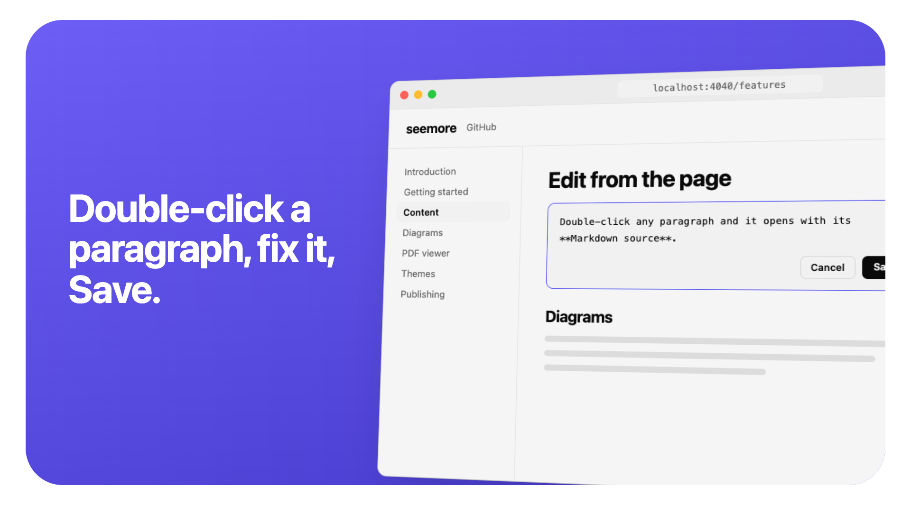
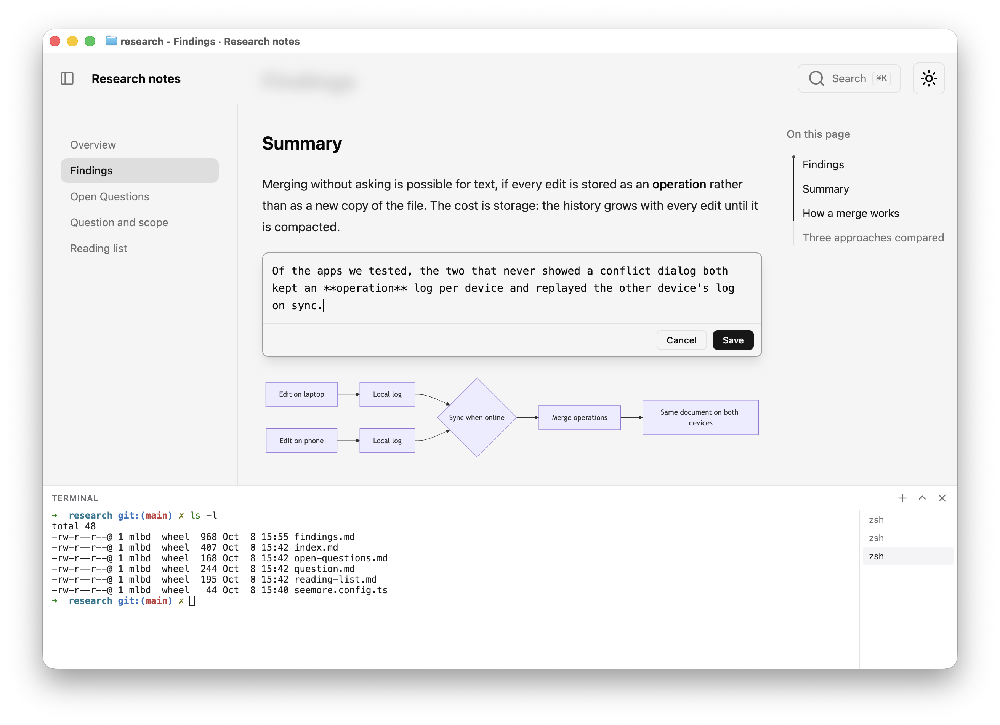
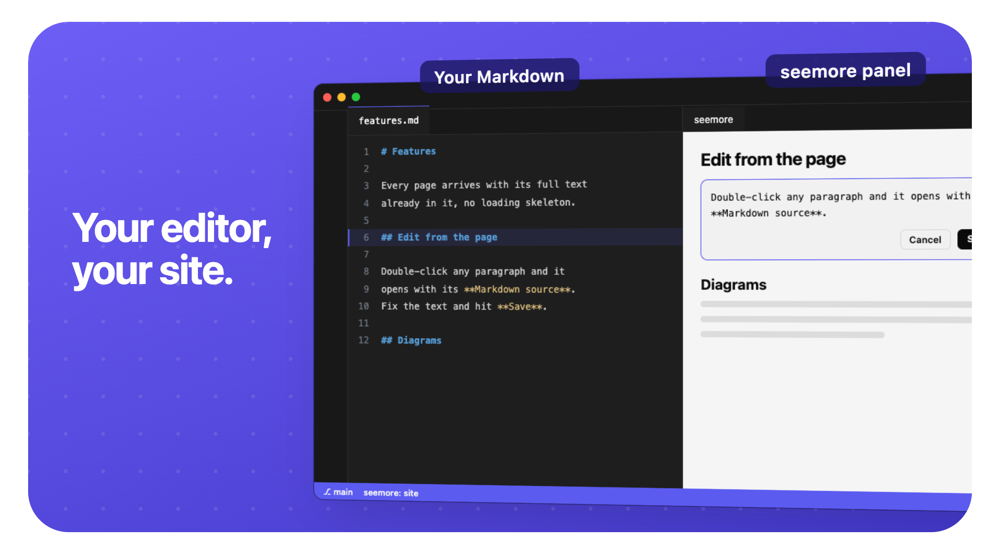
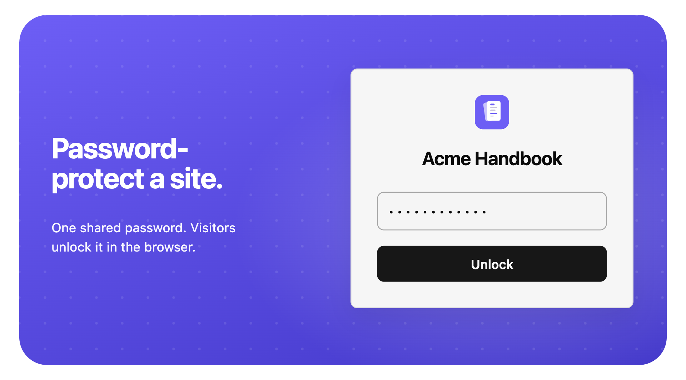
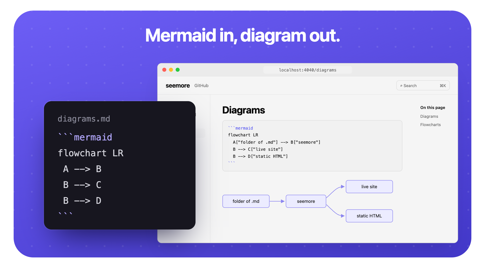
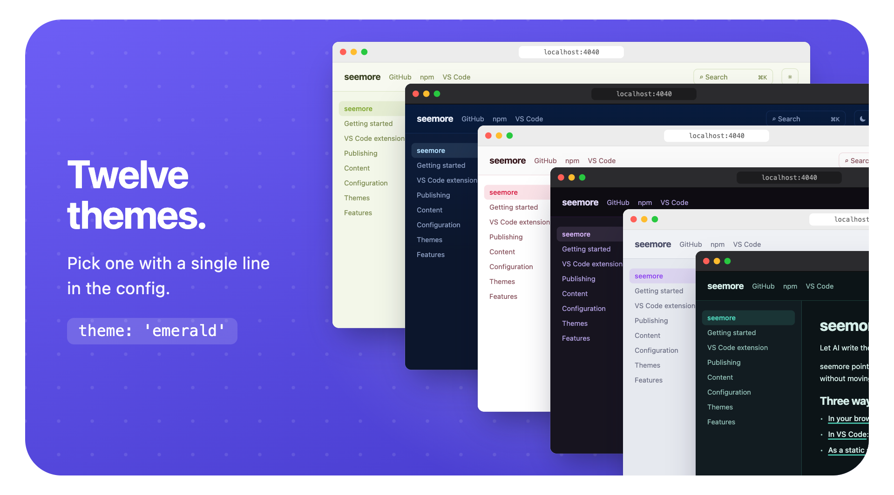

<br/>

<p align="center">
  
  <h4 align="center">Zero config documentation tool - Let AI write the Markdown. Let seemore show it better.</h4>
  <p align="center">
    <a href="https://www.npmjs.com/package/seemore">
      
    </a>
    <a href="https://github.com/arifszn/seemore/actions/workflows/ci.yml">
      
    </a>
    <a href="https://github.com/arifszn/seemore/blob/main/LICENSE">
      
    </a>
  </p>
  <p align="center">
    <a href="https://arifszn.github.io/seemore">Website</a>
    ·
    <a href="https://arifszn.github.io/seemore/quick-start">Quick start</a>
    ·
    <a href="https://arifszn.github.io/seemore/desktop-app">Desktop app</a>
    ·
    <a href="https://open-vsx.org/extension/arifszn/seemore-vscode">Open VSX</a>
    ·
    <a href="https://marketplace.visualstudio.com/items?itemName=arifszn.seemore-vscode">VS Code Marketplace</a>
    ·
    <a href="https://github.com/arifszn/seemore-skill">Agent skill</a>
  </p>
</p>

AI tools write Markdown fast. They write specs, notes, guides, READMEs, and whole folders of files. No person can read that much Markdown at that speed.

**seemore** points at that folder and renders it as a real site. Other docs frameworks need a project first: a scaffold, a config file, a `docs/` layout, and a build step in your repo. seemore needs only a folder that already exists. It does not move your files, and it does not need any code. If you stop using seemore, your files stay where they are.

<video src="https://github.com/user-attachments/assets/7af3ad4f-bb64-4759-913e-77a4182fce90" controls muted playsinline width="100%"></video>

## Quick start

In any folder of Markdown files:

```bash
npx seemore   # renders this folder at http://localhost:4040
```

Open the address it prints. Add, rename, retitle or delete a file, and the site updates at once, navigation and search included. seemore needs [Node.js](https://nodejs.org) 22 or newer.

Prefer not to use a terminal? The same site is available three other ways:

- **[Desktop app](#desktop-app)**
- **[Code editor extension](#code-editor-extension)**
- **[Agent skill](#agent-skill)**

The [quick start](https://arifszn.github.io/seemore/quick-start) covers what seemore does with your folder and what to do next. The [seemore website](https://arifszn.github.io/seemore) is itself a folder of Markdown, rendered by seemore.

## What you get

- **Zero config**: no config file, no code, no files to move
- **[Live preview](https://arifszn.github.io/seemore/live-preview)**: files appear, disappear and reorder in the site as you edit them
- **[Inline editing](https://arifszn.github.io/seemore/live-preview#inline-editing)**: double-click any block in the preview to fix its Markdown
- **[Static build](https://arifszn.github.io/seemore/publishing)**: `seemore build` prerenders every page to HTML, ready for any static host
- **[Password protection](https://arifszn.github.io/seemore/publishing#password-protection)**: encrypt the built site behind one shared password, with no server
- **[Page actions](https://arifszn.github.io/seemore/publishing#share-a-single-page)**: copy a page as Markdown, or export it as one self-contained HTML file for Slack, email or an AI chat
- **[Search](https://arifszn.github.io/seemore/configuration#search)**: static full-text search with no server and no account, with shareable highlighted results. Algolia and Orama Cloud drop in when you want a hosted index
- **[Rich Markdown](https://arifszn.github.io/seemore/content)**: GitHub Flavoured Markdown and alerts, `[[wikilinks]]`, Mermaid and D2 diagrams, click-to-zoom images, embedded PDFs
- **[Full MDX](https://arifszn.github.io/seemore/content#components)**: `.mdx` pages take real JSX, your own React components and CSS
- **[12 themes](https://arifszn.github.io/seemore/themes)**: dark and light follow the system, with a toggle that remembers your choice. Your own CSS always wins

## Edit from the browser

The preview is also an editor. Double-click any paragraph, heading, list item, quote or table cell. A small editor opens with that block's **Markdown source**: `**bold**` stays `**bold**`, links stay links, tables stay tables. Fix the text, press **Save**, and seemore writes the change to the file on disk.

<p align="center">
  
</p>

Inline editing works in the live preview: the command line, the desktop app and the editor extension. A built site has no editor.

## Desktop app

[Download the app](https://arifszn.github.io/seemore/desktop-app) for macOS, Windows or Linux. It opens a folder or a `.md` file as a site in its own window, and needs no Node.js. The integrated terminal opens in the site's folder, so you can run an AI agent, git or a script next to the pages it changes.

<p align="center">
  
</p>

The app can be your default app for Markdown files, and builds or exports a site from its **File** menu.

## Code editor extension

Install **seemore** from [Open VSX](https://open-vsx.org/extension/arifszn/seemore-vscode) for Cursor, Antigravity and other compatible editors, or from the [VS Code Marketplace](https://marketplace.visualstudio.com/items?itemName=arifszn.seemore-vscode). Click the **seemore** icon on any Markdown file, and the rendered site opens beside your editor, scoped to that file's folder. The extension bundles the CLI, so there is no terminal, no `npx` and no browser tab to manage. It works in remote workspaces too.

<p align="center">
  
</p>

## Agent skill

Install the [seemore agent skill](https://github.com/arifszn/seemore-skill), then ask your AI agent for a docs site. It runs the preview, writes pages and publishes. In Claude Code:

```bash
/plugin marketplace add arifszn/seemore-skill
```

```bash
/plugin install seemore
```

For other agents, see [Agent skill](https://arifszn.github.io/seemore/agent-skill).

## Publish it

```bash
npx seemore build  # static export to dist/ for any host
```

The result is a `dist/` folder of plain web files. Drop it on [Netlify](https://netlify.com), [Surge](https://surge.sh), [Cloudflare Pages](https://pages.cloudflare.com) or [GitHub Pages](https://pages.github.com), or hand it to any web host. seemore writes each host's own files for you.

> [!TIP]
> Do you publish to GitHub Pages at `username.github.io/my-repo/`, not at the root? Set the subpath once with `base: '/my-repo/'`. The [publishing guide](https://arifszn.github.io/seemore/publishing#deploy-to-github-pages) has a ready-made GitHub Actions workflow.

### Password-protect a site

Add `auth: true` to `seemore.config.ts`. Set the password when you build:

```bash
SEEMORE_PASSWORD='a-long-passphrase' npx seemore build
```

<p align="center">
  
</p>

seemore encrypts the site content, so nobody can read a copy of the build without the password. A short password can be guessed offline, so use a long one.

### Share a single page

To share one page instead of a site, use the **Actions** button above the page. **Export as HTML** writes one self-contained file that opens offline from a double-click. The CLI does the same without a browser:

```bash
npx seemore export docs/spec.md   # writes spec.html next to the Markdown
```

## Write the Markdown you already have

seemore renders `.md`, `.markdown` and `.mdx`. Markdown written for GitHub renders here too: tables, task lists, `> [!NOTE]` alerts, emoji shortcodes and HTML. **[Mermaid](https://mermaid.js.org)** and **[D2](https://d2lang.com)** diagrams render straight from a ` ```mermaid ` or ` ```d2 ` code fence:

<p align="center">
  
</p>

`[[wikilinks]]` link pages by name, a PDF referenced with image syntax opens inline, and page order comes from a `meta.json` file, a frontmatter `order` field, or the title. The [writing content](https://arifszn.github.io/seemore/content) page renders every syntax seemore supports, live.

## Themes

Twelve built-in colour presets: `neutral` (default), `black`, `catppuccin`, `dusk`, `ocean`, `purple`, `ruby`, `solar`, `aspen`, `emerald`, `vitepress`, `shadcn`. Dark and light modes follow your system setting, with a toggle that remembers your choice. For anything else, add your own CSS.

<p align="center">
  
</p>

## Configuration

Configuration is optional. A folder with no config file works everywhere. To change settings, create `seemore.config.ts` next to your content:

```ts
// seemore.config.ts
export default {
  title: 'My Docs',
  theme: 'ocean',
  base: '/my-repo/',
  nav: [{ text: 'GitHub', link: 'https://github.com/you/repo' }],
  editLink: { base: 'https://github.com/you/repo/edit/main/docs' },
};
```

The [configuration](https://arifszn.github.io/seemore/configuration) page lists every option, and [feature flags](https://arifszn.github.io/seemore/feature-flags) covers the switches for breadcrumbs, prefetching, the table of contents and more.

## CLI

```
seemore [dir]           start the dev server
seemore build [dir]     build a static site into dist/
seemore export <file>   export a page as a standalone HTML file
```

Run `seemore --help` to see the options, or see the [CLI reference](https://arifszn.github.io/seemore/cli-reference).

## FAQ

**Does anything leave my machine?** No. The dev server, the build and the export all run locally, with no account and no telemetry. The only network calls are ones you configure yourself, such as a hosted search provider. The desktop app also checks GitHub for updates, which you can turn off.

**Does seemore move or rewrite my files?** No. seemore reads your folder in place. It writes to a file only when you save an inline edit, or run `build` or `export`.

**Is the password protection real?** Yes. The content is encrypted at build time. There is no per-person access, and no way to revoke one password alone.

**What doesn't it do?** seemore builds one site from one folder. It has no versioned docs and no translations, and the layout is not replaceable with your own React components. If you need those, use a full documentation framework.

## Under the hood

[fumadocs](https://fumadocs.dev) provides the interface presets. [Shiki](https://shiki.style), [Mermaid](https://mermaid.js.org), [D2](https://d2lang.com), [Vite](https://vite.dev) and [React Router](https://reactrouter.com) run underneath it. The code editor extension and the desktop app run the same CLI as a child process they manage.

## Contributing

seemore welcomes bug reports and pull requests. [CONTRIBUTING.md](https://github.com/arifszn/seemore/blob/main/CONTRIBUTING.md) covers how to get the repo running, the checks a pull request must pass, and how releases work.

If seemore saved you time, [give it a star](https://github.com/arifszn/seemore). A star helps other people find it.

## Licence

[MIT](https://github.com/arifszn/seemore/blob/main/LICENSE)
