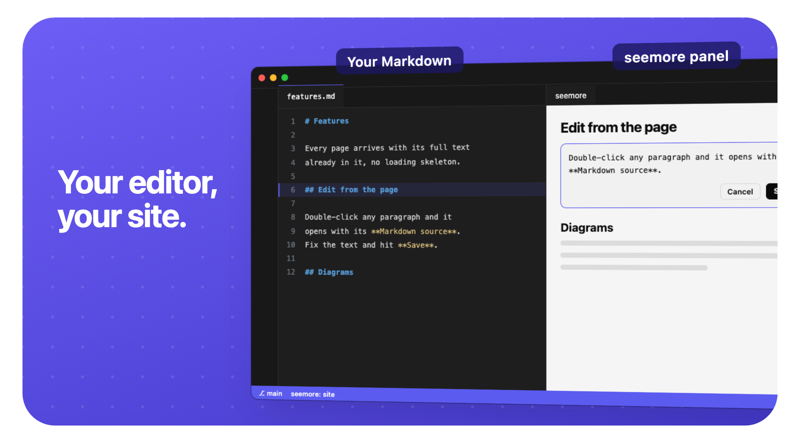

# Code editor extension

Install **seemore** from the [VS Code Marketplace](https://marketplace.visualstudio.com/items?itemName=arifszn.seemore-vscode) or [Open VSX](https://open-vsx.org/extension/arifszn/seemore-vscode). You get the same rendered site as a panel beside your editor, with no terminal, no `npx` and no browser tab to manage. Open VSX also covers VS Code-compatible editors such as Cursor and Antigravity. The panel works in remote workspaces and Codespaces too.

1. Open any Markdown file.
2. Click the **seemore** icon in the editor's title bar, or right-click a folder in the explorer and choose **Open Folder in seemore**.
3. The rendered site opens beside your editor, scoped to that file's folder.

The panel runs the same dev server as `npx seemore`, so everything about the [live preview](./live-preview.md) works here too, including [inline editing](./live-preview.md#inline-editing): double-click a paragraph in the panel, press **Save**, and the file beside you updates.

## Commands

| Command | Where | Does |
| --- | --- | --- |
| **Open in seemore** | Editor title bar, on any Markdown file | Renders that file's folder as a site |
| **Open Folder in seemore** | Explorer, right-click a folder | Renders that folder as a site and pins it as the root |
| **Choose Root** | Status bar item, or the command palette | Pins the folder being served, clears a pinned root, or picks another folder to serve |

## Settings

| Setting | Default | Effect |
| --- | --- | --- |
| `seemore.path` | *(bundled copy)* | Path to a `seemore` CLI entry point to use instead of the version bundled with the extension. Leave empty unless you are developing **seemore** itself. |
