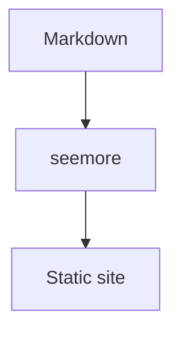
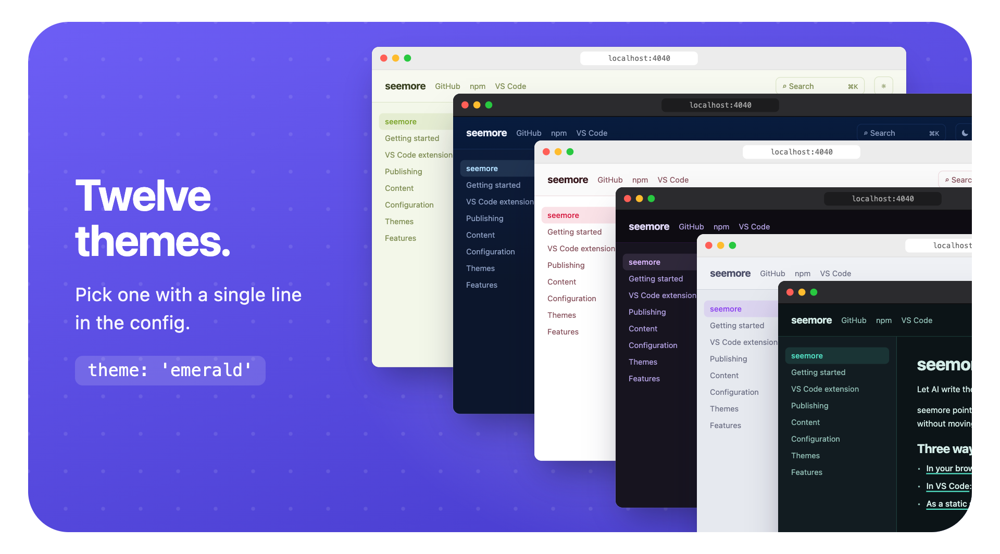

# Writing content

seemore renders `.md`, `.markdown` and `.mdx` files. Markdown written for GitHub renders here too: tables, task lists, alerts, emoji shortcodes and HTML. Everything on this page is rendered live, so you can compare the source with the result.

## Pages and addresses

Each file becomes a page at an address built from its path:

| File | Address |
| --- | --- |
| `index.md` | `/` |
| `README.md` (root) | `/` |
| `getting-started.md` | `/getting-started` |
| `guide/index.md` | `/guide` |
| `guide/Deep Dive.md` | `/guide/deep-dive` |

Both `/guide` and `/guide/` work on every host. If nothing claims `/`, with no root `index.md` and no root `README.md`, seemore generates the home page for you: a card for every page in the site, grouped by folder.

In any one folder, `index.md` wins over `README.md`, and seemore warns and names the file it ignored. Two files that resolve to the same address cause a build error naming both.

[Configuration](./configuration.md#which-files-are-included) lists the folders seemore skips, such as `node_modules` and dot folders, and how to include or exclude more.

## Frontmatter

Frontmatter is optional. seemore reads these keys and lets any others through, so files written for another tool still build:

```md
---
title: Getting Started
description: Install the CLI and run your first build.
icon: Rocket
order: 1
draft: false
---
```

| Key | Effect |
| --- | --- |
| `title` | The page title in the sidebar, the browser tab and search. Without it, seemore uses the file name: `getting-started.md` becomes **Getting Started** |
| `description` | The page's meta description, used by search engines and link previews |
| `icon` | A [Lucide](https://lucide.dev/icons) icon name, such as `BookOpen`, shown next to the page in the sidebar |
| `order` | The page's position in the sidebar. Lower numbers come first. See [Ordering](#ordering) |
| `draft` | `true` keeps the page in the live preview but leaves it out of `seemore build` |

A key with the wrong type, such as `order: first`, fails the build with the file and field named.

## Ordering

Pages are ordered by:

1. `meta.json` in the folder, an explicit list, with `...` standing in for anything you did not name:

   ```json
   { "pages": ["getting-started", "installation", "..."] }
   ```

   A list entry written as `---Label---` adds a section label to the sidebar. This site's own [`meta.json`](https://github.com/arifszn/seemore/blob/main/packages/site/meta.json) uses them.

2. Frontmatter `order`, lower numbers first.

3. Alphabetical by title, for anything left unordered by the two above.

## Alerts

GitHub's alert syntax renders as a callout:

```md
> [!NOTE]
> seemore reads your folder in place. It never moves your files.

> [!WARNING]
> Set `base` before you publish to a subpath, such as GitHub Pages.
```

> [!NOTE]
> seemore reads your folder in place. It never moves your files.

> [!WARNING]
> Set `base` before you publish to a subpath, such as GitHub Pages.

All five kinds work: `NOTE`, `TIP`, `IMPORTANT`, `WARNING` and `CAUTION`. The `:::note` form also works, with `note`, `tip`, `info`, `warn`, `warning` and `danger`. Leave a blank line after the opening line and before the closing one:

```md
:::tip

Use `npx seemore --open` to open the browser for you.

:::
```

## Links

A relative link to another Markdown file becomes a link to that page, with the base path added for you:

```md
See the [configuration](./configuration.md) page.
```

`[[wikilinks]]` link pages by name, so you do not have to get the relative path right:

```md
[[Themes]]                 links to the Themes page
[[Themes|colour presets]]  with your own label
[[Themes#Custom CSS]]      to a heading on that page
```

A wikilink matches a file path first, then a file name anywhere in the folder. One that matches nothing renders as plain text and shows as a warning.

## Emoji and HTML

GitHub's emoji shortcodes work in text: `:white_check_mark:` renders as :white_check_mark:, and Slack's `:large_yellow_circle:` as :large_yellow_circle:. A shortcode inside inline code or a code block stays as written.

HTML in a `.md` file renders as HTML, as it does on GitHub:

```md
<details>
<summary>Show the full log</summary>

The log goes here.

</details>
```

In an `.mdx` file, tags are JSX instead. See [Components](#components).

## Code blocks

[Shiki](https://shiki.style) highlights code fences at build time, in the theme's own colours.

Settings go on the code fence line, after the language:

````md
```ts title="server.ts" lineNumbers
const port = 4040;
```
````

| On the code fence | Effect |
| --- | --- |
| `title="server.ts"` | Filename bar above the block |
| `lineNumbers` | Numbers down the side. `lineNumbers=5` starts the count at 5 |
| `noCopy` | No copy button on this one block |

Comments mark individual lines and never reach the page. The block below uses all five:

```ts title="marked.ts"
const marked = 1; // [!code highlight]
const added = 2; // [!code ++]
const removed = 3; // [!code --]
const focused = 4; // [!code focus]
const found = 'needle'; // [!code word:needle]
```

| In the code | Effect |
| --- | --- |
| `[!code highlight]` | Marks the line |
| `[!code ++]`, `[!code --]` | Diff lines: green with a `+`, red with a `-` |
| `[!code focus]` | Blurs every other line until the pointer is over the block |
| `[!code word:needle]` | Marks that word everywhere it appears in the block |

The marker follows the language's own comment syntax, so `# [!code highlight]` in Python and `<!-- [!code highlight] -->` in HTML.

The copy button is on by default. `noCopy` drops it from one block. `'content.code.copy': false` drops it from every block on the site.

## Diagrams

A ` ```mermaid ` or ` ```d2 ` code fence renders as a diagram in the browser, with no build step and no external service.

````md

````


[D2](https://d2lang.com) works the same way:

````md
```d2
Markdown -> seemore -> Static site
```
````

```d2
Markdown -> seemore -> Static site
```

## Images, PDFs and media

Images next to the page are bundled with the site. Click any content image to zoom in. Turn that off with `'content.image.zoom': false`.



Reference a PDF with image syntax, and it opens inline in the browser's own viewer, with a download link underneath. A file next to the page or a remote URL both work:

```md

```


Files referenced from a `<video>`, `<audio>`, `<source>` or `<track>` tag are bundled the same way as images:

```md
<video src="./demo.mp4" controls></video>
```

A missing image shows as a warning and a visibly broken image, not a failed build.

## Steps

Numbered headings become a numbered sequence, with the rule and the marker drawn for you:

```md
## 1. Install it

## 2. Point it at a folder
```

The [Quick start](./quick-start.mdx) page uses them.

## Components

An `.mdx` file can use these without importing anything:

| Component | What it is |
| --- | --- |
| `<Callout type="warn" title="…">` | The box an alert produces. `type` is `info`, `warn`, `error`, `success` or `idea` |
| `<Card>`, `<Cards>` | Link cards, one per linked page, laid out in a grid |
| `<CodeBlockTabs>` | One code block per tab: npm, pnpm, yarn, bun |
| `<Mermaid>`, `<D2>` | What a ` ```mermaid ` or ` ```d2 ` code fence compiles to. You can also use it directly |
| `<Pdf>` | The viewer a linked PDF opens in |
| `<Term tip="…" image="…">` | A word with a hint that opens on hover, tap or keyboard focus. `image` is a file next to the page, like any other image |

This set stays small on purpose. Markdown has no imports, so **seemore** ships every component to every site, whether a page uses it or not. Each one pairs with something Markdown already expresses, except `<Term>`: Markdown has no syntax for an inline hint. Any other component (fumadocs' `<Tabs>`, `<Accordions>` and `<Files>` among them) fails the build. The error names the file and the component. In a plain `.md` file a tag is HTML, not JSX: `<Callout>` renders as an unknown element with its text inside, rather than as the component. Components need the `.mdx` extension for that reason.

### Term

A term goes inline, inside a sentence. Give it a `tip`, an `image`, or both:

```mdx
Link pages with a <Term tip="A link written as a page's title in double brackets, like [[Themes]].">wikilink</Term>.

Draw a flowchart in <Term tip="A text syntax for diagrams. A mermaid code fence renders as the diagram." image="./assets/diagrams.png">Mermaid</Term>.
```

Link pages with a <Term tip="A link written as a page's title in double brackets, like [[Themes]].">wikilink</Term>.

Draw a flowchart in <Term tip="A text syntax for diagrams. A mermaid code fence renders as the diagram." image="./assets/diagrams.png">Mermaid</Term>.

### Code tabs

Code tabs need a `defaultValue`, or the block opens with no tab selected and nothing under it. Leave a blank line around each code fence:

````mdx
<CodeBlockTabs defaultValue="npm">
  <CodeBlockTabsList>
    <CodeBlockTabsTrigger value="npm">npm</CodeBlockTabsTrigger>
    <CodeBlockTabsTrigger value="pnpm">pnpm</CodeBlockTabsTrigger>
  </CodeBlockTabsList>
  <CodeBlockTab value="npm">

```bash
npm i seemore
```

  </CodeBlockTab>
  <CodeBlockTab value="pnpm">

```bash
pnpm add seemore
```

  </CodeBlockTab>
</CodeBlockTabs>
````
