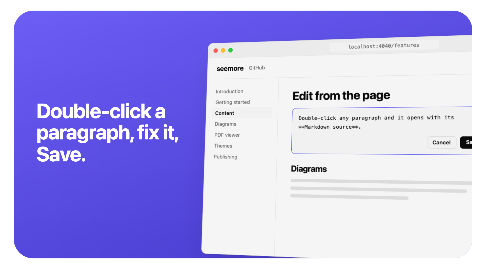

import { useRef, useState } from 'react';
import promo from './assets/seemore.mp4';
import poster from './assets/seemore-poster.jpg';
import posterDark from './assets/seemore-poster-dark.jpg';

export const FEATURES = [
  ['Zero config', 'No config file, no code, no files to move. A plain folder of Markdown works in the browser, in your editor, and as a static build.'],
  ['Live preview', 'Add, rename, retitle or delete a file and the site updates immediately, navigation and search included.'],
  ['Edit in place', 'Double-click any block in the preview to fix its Markdown, and seemore writes the change straight back to the file.'],
  ['Editor integration', 'One extension covers VS Code, Cursor, Antigravity and other VS Code-compatible editors, remote workspaces included.'],
  ['Documentation framework', "seemore build prerenders the whole site to HTML, ready to deploy anywhere, and writes each host's convention files for you."],
  ['Password protection', 'Protect the built site with one shared password. No server is needed. Visitors unlock it in the browser.'],
  ['Page actions', 'Copy a page as Markdown, or export it as one self-contained HTML file to drop into Slack, email or an AI chat.'],
  ['Search built in', 'Static, zero-setup full-text search out of the box, with shareable highlighted results. Algolia and Orama Cloud for hosted indexes.'],
  ['Rich Markdown', 'GitHub Flavoured Markdown, admonitions, steps, [[wikilinks]], Mermaid and D2 diagrams, click-to-zoom images, embedded PDFs.'],
  ['Full MDX', 'When Markdown is not enough, .mdx pages take real JSX: your own components, inline SVG and custom CSS. This page is built that way.'],
  ['12 themes', 'Dark and light follow the system, with a toggle that remembers your choice. Your own CSS always wins.'],
];

{/* The promo film behind a cover: a poster for each theme and a play button. The video's own
    controls appear once it plays. */}
export function HeroVideo() {
  const video = useRef(null);
  const [started, setStarted] = useState(false);
  const play = () => {
    setStarted(true);
    video.current?.play();
  };
  return (
    

      <video ref={video} src={promo} controls={started} muted playsInline preload="none"></video>
      {!started && (
        <button type="button" className="seemore-video-cover" aria-label="Play the seemore video" onClick={play}>
          
          
          
            <svg viewBox="0 0 10 12" aria-hidden="true"><path d="M0 0L10 6L0 12z" /></svg>
          
        </button>
      )}
    

  );
}

<h1 className="seemore-hero-title">
  Let AI write the Markdown. 
  Let seemore show it better.
</h1>

  AI tools write Markdown fast: specs, notes, guides, READMEs, whole folders of it. A folder of
  `.md` files has no order: nothing to click, nothing to search. **seemore** points at that folder
  and renders it as a real site. It does not move a single file or need any code.

  <Link className="seemore-btn seemore-btn-primary" href="/desktop-app">
    <svg className="seemore-btn-icon" viewBox="0 0 24 24" fill="none" stroke="currentColor" strokeWidth="2.25" strokeLinecap="round" strokeLinejoin="round" aria-hidden="true">
      <path d="M12 4v11" />
      <polyline points="7 11 12 16 17 11" />
      <line x1="5" y1="20" x2="19" y2="20" />
    </svg>
    Download Desktop App
  </Link>
  <Link className="seemore-btn seemore-btn-secondary" href="https://github.com/arifszn/seemore">View on GitHub</Link>

  or run it from a terminal:
  <Link className="seemore-cli-chip" href="/cli">❯npx seemore</Link>

<HeroVideo />

zero config · static export · inline editing

## Two ways to use it

Same folder, same Markdown, wherever you look at it.

<Link className="seemore-way" href="/desktop-app">
  
    
      
        <svg viewBox="0 0 24 24" fill="none" stroke="currentColor" strokeWidth="1.5" strokeLinecap="round" strokeLinejoin="round">
          <rect x="2" y="4" width="20" height="13" rx="2" />
          <line x1="8" y1="21" x2="16" y2="21" />
          <line x1="12" y1="17" x2="12" y2="21" />
        </svg>
      
      In the desktop app
    
    Open a folder or a .md file as a site, with an integrated terminal. For macOS, Windows and Linux.
  
</Link>

<Link className="seemore-way" href="/cli">
  
    
      
        <svg viewBox="0 0 24 24" fill="none" stroke="currentColor" strokeWidth="1.5" strokeLinecap="round" strokeLinejoin="round">
          <rect x="3" y="4" width="18" height="16" rx="2" />
          <line x1="3" y1="9" x2="21" y2="9" />
          <circle cx="6.5" cy="6.5" r="0.6" fill="currentColor" stroke="none" />
          <circle cx="8.7" cy="6.5" r="0.6" fill="currentColor" stroke="none" />
        </svg>
      
      In the terminal
    
    npx seemore serves the folder you are in to your browser and updates live as you edit.
  
</Link>

## What you get

Point seemore at any Markdown you already have: AI-written notes, project docs, RFCs, API
references, specs, an engineering handbook.

  {FEATURES.map(([title, text], i) => (
    

      {String(i + 1).padStart(2, '0')}
      

        
{title}

        
{text}

      

    

  ))}

## How seemore is different

  Starts where your files already are
  Most docs frameworks need a project: a scaffold, a config file, a docs/ layout, a build step wired into your repo. seemore needs only a folder that already exists.

  Nothing to migrate, nothing to undo
  seemore never moves or rewrites your files. You can stop using it at any time, at no cost.

## Edit without leaving the page

While a preview is open, the rendered page is also an editor. Double-click any paragraph to fix
its Markdown in place. seemore writes the change straight back to the file.

  

