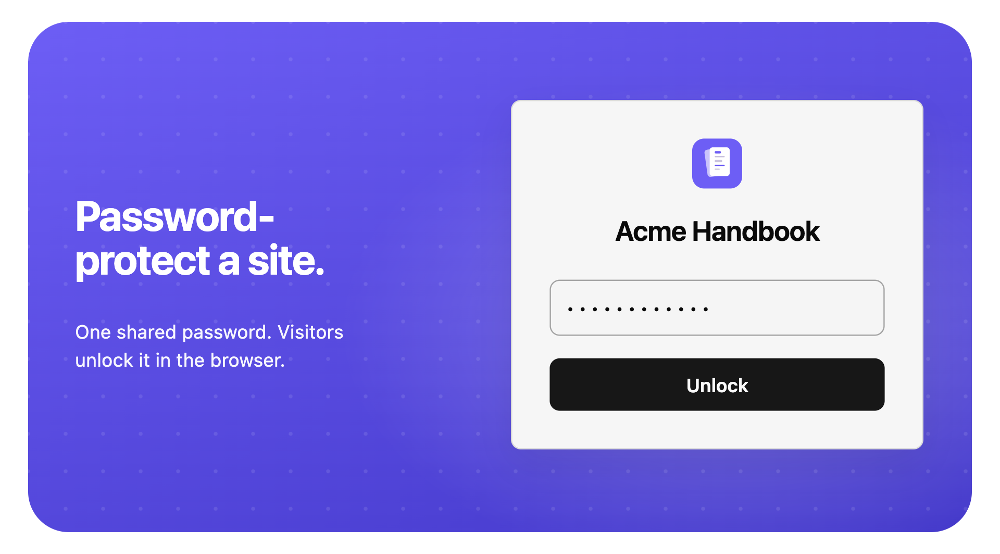

# Publishing

<CodeBlockTabs defaultValue="npm">
  <CodeBlockTabsList>
    <CodeBlockTabsTrigger value="npm">npm</CodeBlockTabsTrigger>
    <CodeBlockTabsTrigger value="pnpm">pnpm</CodeBlockTabsTrigger>
    <CodeBlockTabsTrigger value="yarn">yarn</CodeBlockTabsTrigger>
    <CodeBlockTabsTrigger value="bun">bun</CodeBlockTabsTrigger>
  </CodeBlockTabsList>
  <CodeBlockTab value="npm">

```bash
npx seemore build  # static export to dist/ for any host
```

  </CodeBlockTab>
  <CodeBlockTab value="pnpm">

```bash
pnpm dlx seemore build  # static export to dist/ for any host
```

  </CodeBlockTab>
  <CodeBlockTab value="yarn">

```bash
yarn dlx seemore build  # static export to dist/ for any host
```

  </CodeBlockTab>
  <CodeBlockTab value="bun">

```bash
bunx seemore build  # static export to dist/ for any host
```

  </CodeBlockTab>
</CodeBlockTabs>

The result is a `dist/` folder of plain web files. Drop it on [Netlify](https://netlify.com), [Surge](https://surge.sh), [Cloudflare Pages](https://pages.cloudflare.com) or [GitHub Pages](https://pages.github.com), or hand it to any web host. Every page is prerendered to its own `index.html` with its full text, next to a `404.html` that every static host reads. seemore also writes the files each host needs: `_redirects` for Netlify and Cloudflare Pages, `200.html` for Surge, `.nojekyll` for GitHub Pages.

In the [desktop app](./desktop-app.mdx), **File > Build Site** does the same without a terminal.

## Base path

If the site is served from a subpath, such as `username.github.io/my-repo/` on GitHub Pages, set the subpath once:

```ts
// seemore.config.ts
export default {
  title: 'My Docs',
  base: '/my-repo/',
};
```

Or pass `--base /my-repo/` to `seemore build`. Without it, the pages load with no styles and broken links. seemore never guesses the base path, but a build inside GitHub Actions with no `base` set prints the exact line to add.

## Deploy to GitHub Pages

This workflow builds the site on every push to `main` and publishes it. In the repository's **Settings > Pages**, set **Source** to **GitHub Actions** first.

```yaml title=".github/workflows/docs.yml"
name: Deploy docs

on:
  push:
    branches: [main]
  workflow_dispatch:

permissions:
  contents: read
  pages: write
  id-token: write

concurrency:
  group: deploy-docs
  cancel-in-progress: false

jobs:
  build:
    runs-on: ubuntu-latest
    steps:
      - uses: actions/checkout@v5
      - uses: actions/setup-node@v5
        with:
          node-version: 22
      - run: npx --yes seemore build docs  # the folder your Markdown is in
      - uses: actions/configure-pages@v6
      - uses: actions/upload-pages-artifact@v5
        with:
          path: dist

  deploy:
    needs: build
    runs-on: ubuntu-latest
    environment:
      name: github-pages
      url: ${{ steps.deployment.outputs.page_url }}
    steps:
      - id: deployment
        uses: actions/deploy-pages@v5
```

`dist/` is written in the folder the command runs from. Pass `--out <dir>` to write it elsewhere, and change `path` to match.

This site deploys the same way. See its [workflow](https://github.com/arifszn/seemore/blob/main/.github/workflows/deploy-site.yml) and [`seemore.config.ts`](https://github.com/arifszn/seemore/blob/main/packages/site/seemore.config.ts).

## Search engines and link previews

### Sitemap

A sitemap lists absolute URLs, so seemore needs the address the site is served from. Set `url` to the origin and `seemore build` writes `sitemap.xml` into `dist/`, with one entry per page under your `base`:

```ts
// seemore.config.ts
export default {
  title: 'My Docs',
  url: 'https://username.github.io',
  base: '/my-repo/',
};
```

Without `url`, nothing is written. A password-protected site never gets a sitemap, since the file would list every page address. Submit the file in your search engine's webmaster tools; seemore does not write a `robots.txt`.

### Social cards

Turn on the `social.cards` [feature flag](./feature-flags.md) and `seemore build` renders a preview image for every page, with its title and description, and adds it to the page's Open Graph tags:

```ts
features: { 'social.cards': true },
```

## Password protection

Protect a whole site with one shared password. No server or account is needed. Turn it on in
`seemore.config.ts`:

```ts
// seemore.config.ts
export default {
  title: 'Acme Handbook',
  auth: true,
};
```

Keep the password out of the config file. `seemore build` reads it from the `SEEMORE_PASSWORD`
environment variable. The build fails if the variable is missing:

```bash
SEEMORE_PASSWORD='a-long-passphrase' npx seemore build
```

On Windows PowerShell:

```powershell
$env:SEEMORE_PASSWORD='a-long-passphrase'; npx seemore build
```

In GitHub Actions, store the password as a repository secret and pass it to the build step:

```yaml
- run: npx --yes seemore build docs
  env:
    SEEMORE_PASSWORD: ${{ secrets.SEEMORE_PASSWORD }}
```



The build encrypts the site content and search index. The output is still a plain `dist/` folder that you can deploy to any of the hosts above.

- **What it protects.** Page text, page addresses and the search index. Someone with a copy of `dist/` cannot read them without the password.
- **What stays visible.** The site title, description and favicon, which the lock screen shows, and the number and size of the files.
- **Choose a long password.** A short one can be guessed offline from a copy of the files.
- **No per-person access.** Everyone shares one password. To remove someone's access, change the password and rebuild.
- Search engines are asked not to index a protected site, and it gets no sitemap. `social.cards` and hosted search cannot be combined with it, because both would publish page content.

### Staying unlocked

`remember` sets how long a visitor stays unlocked after their last visit. The default is one day:

```ts
auth: { remember: '12h' }  // hours
auth: { remember: '7d' }   // days
```

Renaming the site logs everyone out once. To avoid that, set a stable `id`. Changing `id` logs everyone
out, just like changing the password:

```ts
auth: { id: 'acme-handbook' }
```

> [!NOTE]
> Password protection works only for `seemore build`. To try the lock screen, build with the password and serve
> `dist/` on `localhost`, for example with `npx serve dist` (build with `--base /` if the site sets `base`).

## Share a single page

To share one page rather than a site, use the **Actions** button above the page:

- **Copy as Markdown** puts the page's own Markdown on your clipboard, ready to paste into an AI chat, an issue or another document. It is the source, not a transcription of the rendered page: a GitHub alert is still `> [!NOTE]`, a diagram is still a ```` ```mermaid ```` fence, and an `.mdx` page's components come across as the JSX the author wrote.
- **Export as HTML** writes the page into one self-contained HTML file, with styles inlined, images embedded and diagrams kept. It opens offline from a double-click, so it can go into Slack or an email as a file.

The command line writes the same file, with no browser:

```bash
npx seemore export docs/spec.md   # writes spec.html next to the Markdown
```

`--out <dir>` writes it to another folder. In the desktop app, use **File > Export Page as HTML**.

An exported file keeps the theme toggle, code copy buttons, click-to-zoom and an "On this page" list. It leaves out the sidebar, navbar and search. It opens in the reader's own light or dark mode. Remote images, such as GitHub URLs, stay remote; everything local is embedded.

To make a PDF, print the exported file or the live page and choose **Save as PDF**. Printing strips the site's chrome and does not split blocks across pages.

The `pageActions` key in [`seemore.config.ts`](./configuration.md#page-actions) chooses which actions the button shows.
