# Themes

seemore has twelve built-in colour presets. Set one with `theme` in [seemore.config.ts](./configuration.md):

```ts
// seemore.config.ts
export default {
  title: 'My Docs',
  theme: 'ocean',
};
```

Every theme has a light and a dark mode. The site follows the reader's system setting, with a toggle that remembers their choice. `black` is built for dark mode, and the image below shows it that way.

| `neutral` (default) | `black` |
| :--- | :--- |
| 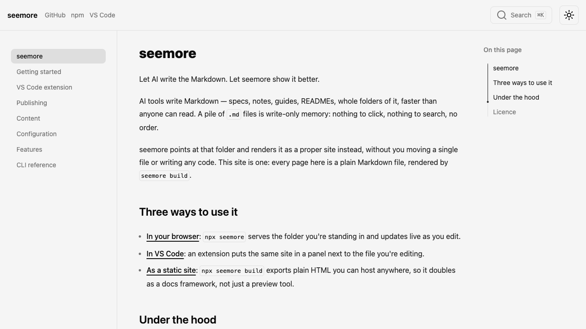 | 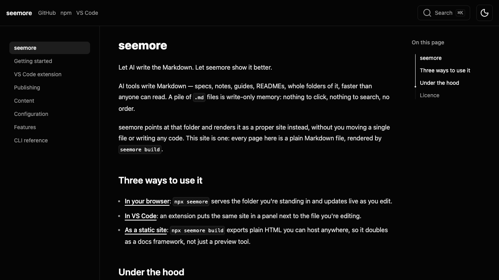 |

| `catppuccin` | `dusk` |
| :--- | :--- |
| 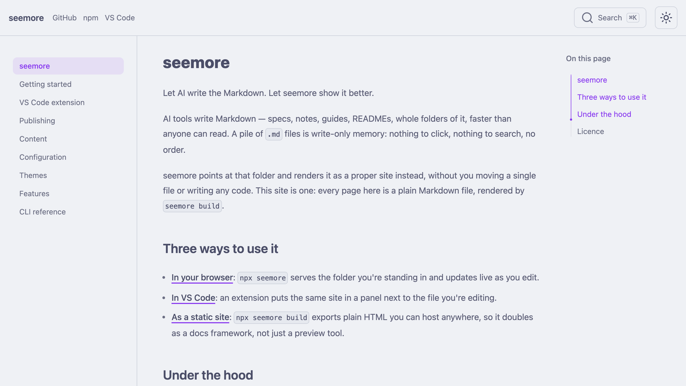 | 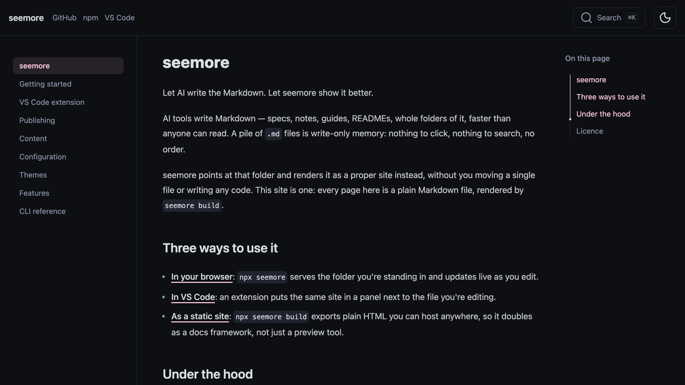 |

| `ocean` | `purple` |
| :--- | :--- |
| 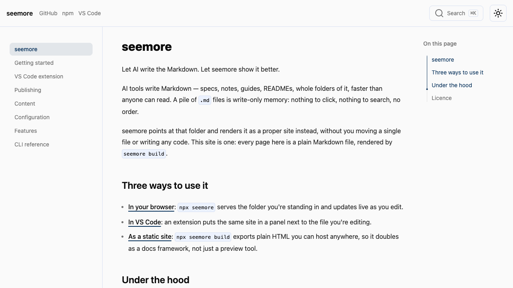 | 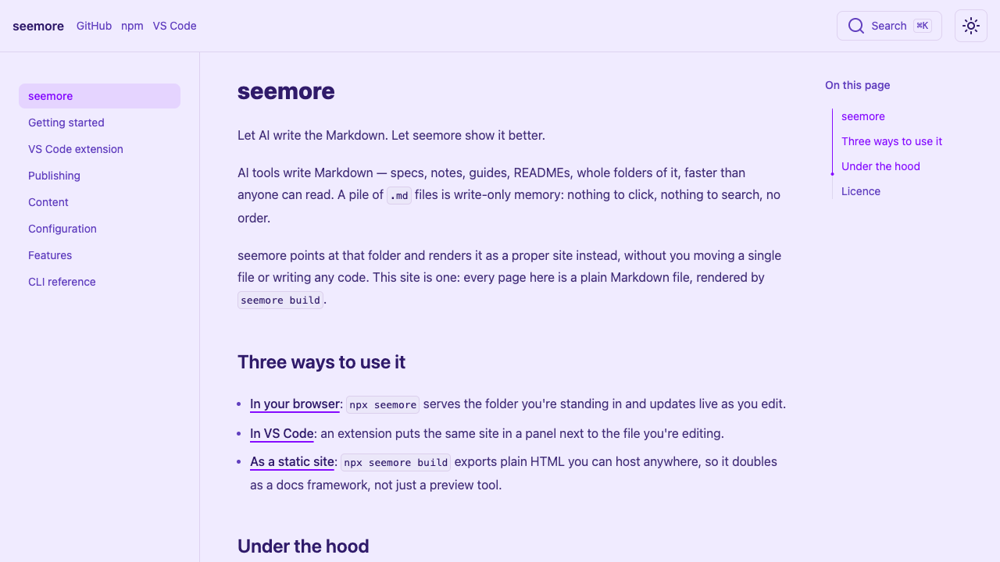 |

| `ruby` | `solar` |
| :--- | :--- |
| 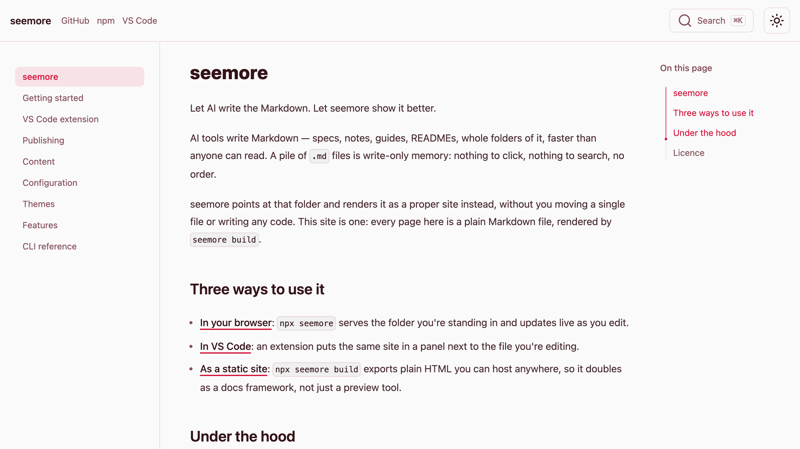 | 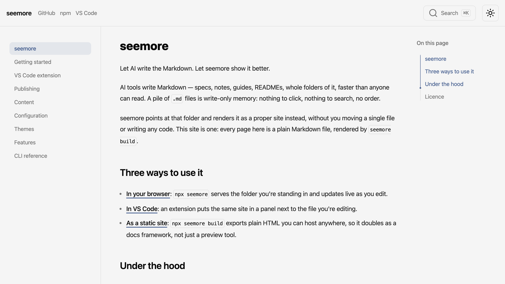 |

| `aspen` | `emerald` |
| :--- | :--- |
| 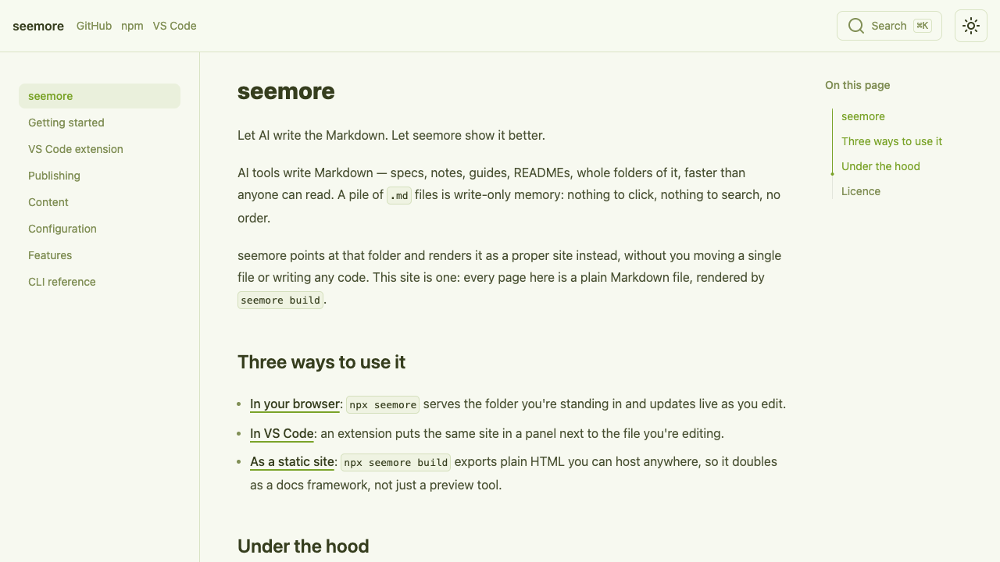 | 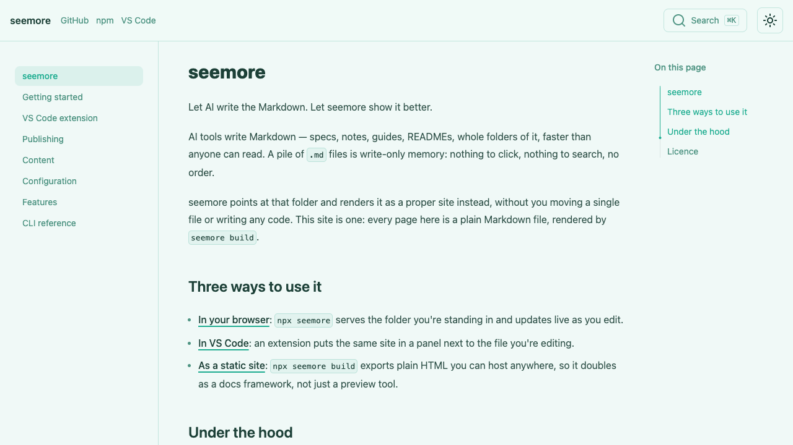 |

| `vitepress` | `shadcn` |
| :--- | :--- |
| 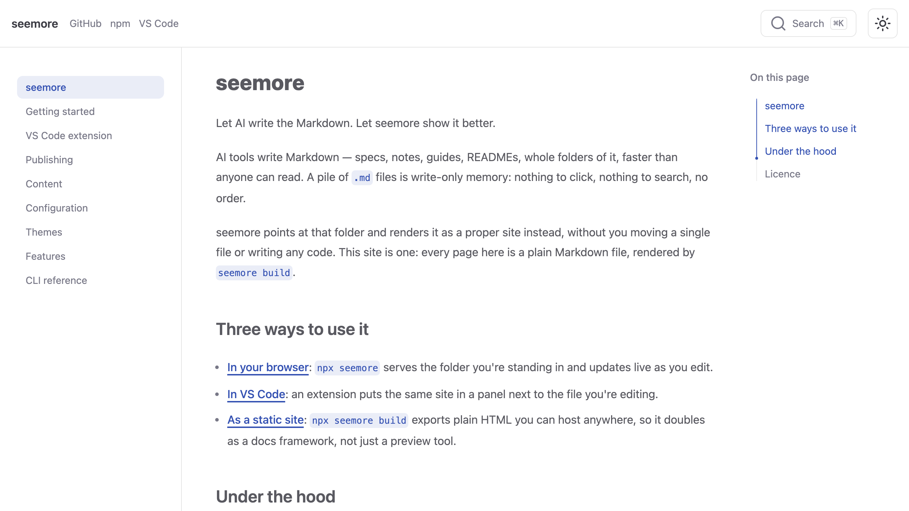 | 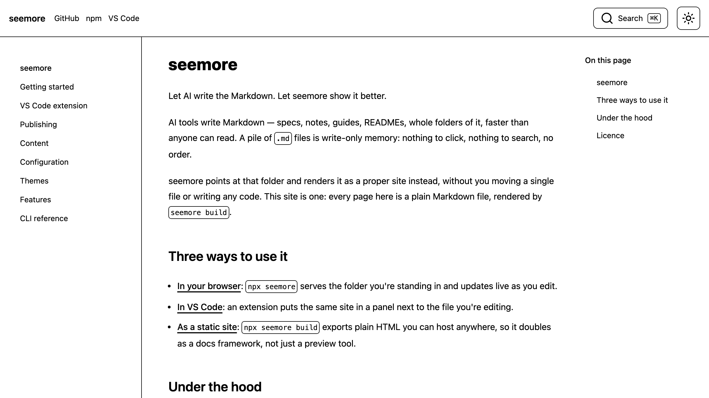 |

## Custom CSS

For anything a preset does not cover, point `css` at your own stylesheet. seemore adds it after everything else, so your rules win:

```ts
// seemore.config.ts
export default {
  title: 'My Docs',
  css: './custom.css',
};
```

The themes are built on [fumadocs](https://fumadocs.dev) colour variables, named `--color-fd-*`. Override them to change a colour everywhere it is used, in light mode under `:root` and in dark mode under `.dark`:

```css title="custom.css"
:root {
  --color-fd-primary: #4f46e5;
}

.dark {
  --color-fd-primary: #a5b4fc;
}
```
